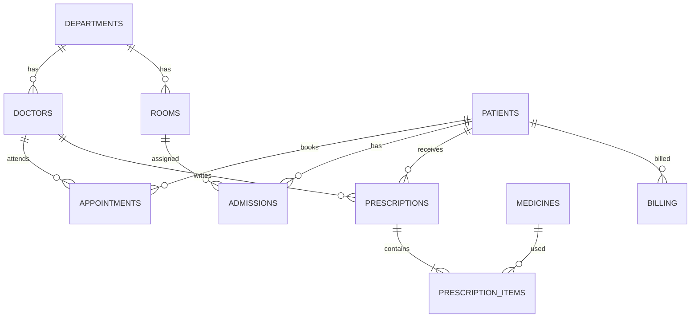

# Hospital Management System (HMS)

Spring Boot 3.4 / Java 21 backend with PostgreSQL, Flyway, JWT and Swagger, plus a React + Vite
frontend in `hms-frontend-react/`. The older Vue app in `hms-frontend/` is kept for reference only.

## Quick start

1. Create a PostgreSQL database named `HMS_DB`.
2. Copy `.env.example` to `.env` and fill in the database password, a 32+ character `JWT_SECRET`, and the
   `INITIAL_ADMIN_*` values. `application.properties` imports `.env` automatically from the project root,
   so no IDE configuration is needed. Never commit `.env`.
3. Start the backend: `mvn spring-boot:run`. Flyway creates the schema on first start.
4. Create the first administrator once: `curl -X POST http://localhost:8080/api/v1/auth/initial-admin`.
5. Start the frontend: `cd hms-frontend-react && npm install && npm run dev`, then open http://localhost:5173.

Swagger UI is at http://localhost:8080/swagger-ui.html.

## Roles

| Role | Can do |
|---|---|
| ADMIN | Everything, including deleting records and creating login accounts |
| DOCTOR, RECEPTIONIST | Day-to-day records: patients, appointments, admissions, prescriptions, billing. Cannot delete. |

The server enforces every rule. The frontend only hides controls the user cannot use.

## Business rules

- **Appointments** move `SCHEDULED → CONFIRMED → COMPLETED`, and may be `CANCELLED` from either open state.
  Any other transition is rejected. A doctor cannot be booked twice at the same time.
- **Rooms** are occupied only through an admission. A room with an active admission cannot be marked
  available. Deleting an active admission frees its room.
- **Admissions** are discharged once. Discharge frees the room.
- **Appointment bills** = consultation fee + additional charges. Cancelled appointments cannot be billed.
- **Admission bills** = `max(1, whole stay days) × room daily rate + additional charges`, issued only after
  discharge, for the admitted patient. One bill per appointment or admission.

## API checks

`scripts/api-smoke-test.py` runs 32 end-to-end checks against a running backend (see the header of the file for the
accounts it expects). The unit tests run with `mvn test`.

## Frontend tests

```bash
cd hms-frontend-react
npm test                                  # offline unit tests
HMS_LIVE=1 npx vitest run src/live.integration.test.jsx   # UI against the running backend
```

## Security notes

- The JWT is stored in `localStorage` because the API issues bearer tokens rather than HttpOnly cookies.
  Serve production traffic over HTTPS and avoid untrusted scripts.
- Rotate any credentials that were ever stored in a shared or exported copy of `.env`.
- The backend has no CORS configuration. Production hosting of the frontend on another origin needs
  an explicit allow-list in `SecurityConfig`.

## ERD


